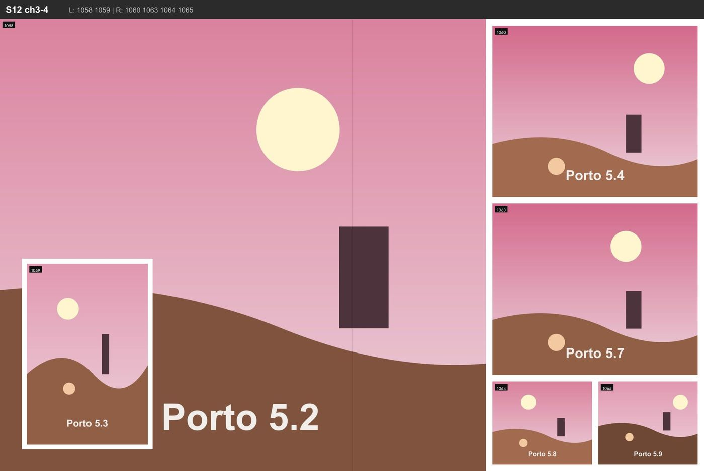
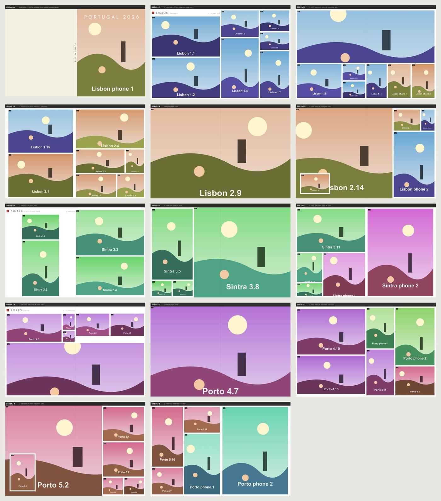
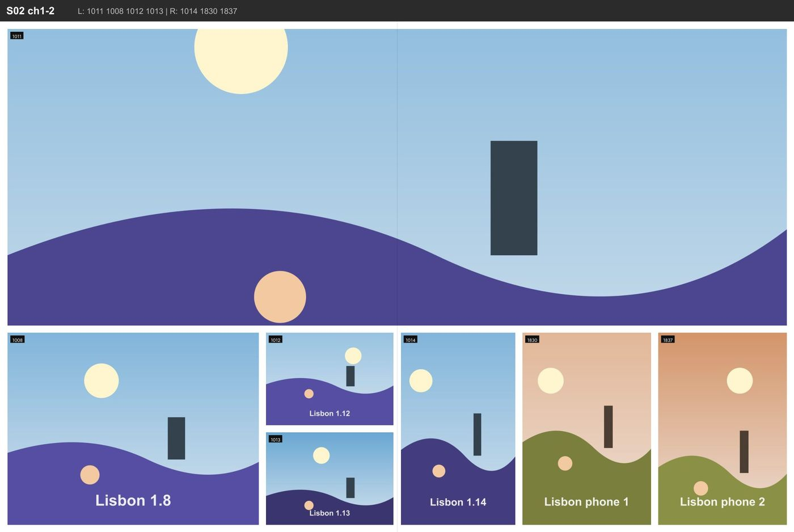
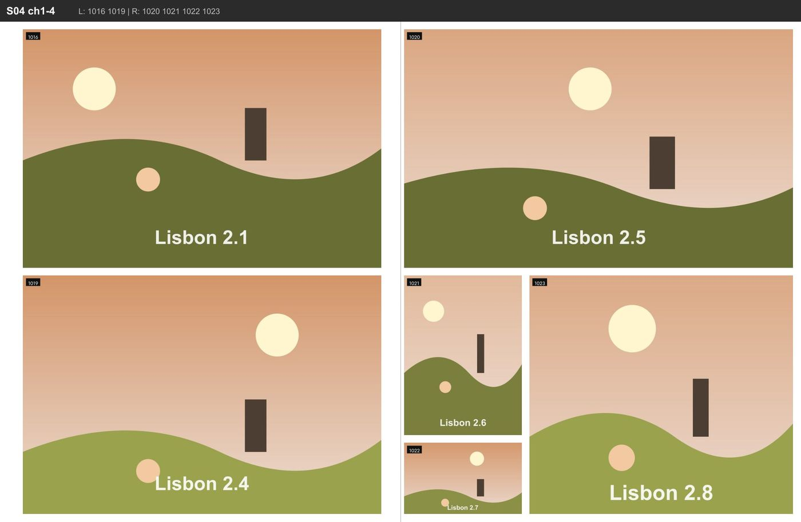

# Photobook Maker

A Claude Code plugin that turns a folder of photos into a print-ready photo book. You answer a few questions, pick photos on a local page, and review previews. Claude does the layout and produces the files for the printer.



<sub>All example images come from the generated test set (78 synthetic photos).</sub>

## How it works

1. **Book type.** Claude asks what the book is for, the shape and size, the budget, and whether you want layflat binding.
2. **Printing service.** It suggests services that fit and picks the matching format: page size, bleed, spine width per page count, page-count rules.
3. **Photos.** You point it to a folder. It reads dates, GPS and camera from the EXIF data and suggests chapters (by place, day or month). It also flags near-duplicates and files too small to print large.
4. **Picking.** A local web page shows every photo per chapter. Mark each one yes / maybe / no (keys 1 / 2 / 3), and add a note if you like. Everything is saved to a file in the book folder.
5. **Layout.** The engine designs all spreads for the chosen format. Layflat books get full-spread photos, photos across the fold and overlapping prints; other books keep everything clear of the binding. Photos marked yes get the larger places.
6. **Review rounds.** Previews show a short code on each photo, so you can write notes like "swap 1234 and 1250" under a spread. Claude applies them and renders again.
7. **Export.** Print PDFs (content and cover), or 300 ppi page images for services with their own editor. Every export includes a resolution report and a PDF preflight.

The original photos are only read, never changed or moved, and nothing is uploaded.



The same selection laid out for a layflat book (left) and a book with a normal binding (right):

| layflat | normal binding |
|---|---|
|  |  |

## Install

Requirements: the Claude desktop app (a paid plan, for the Code tab) and Node.js 20 or newer. See [docs/INSTALL.md](docs/INSTALL.md) for a step-by-step guide.

```
/plugin marketplace add arnegold/photobook-maker
/plugin install photobook@photobook-maker
```

Then start a session in the Code tab and say "make me a photobook".

## Printing services

| service | formats | upload |
|---|---|---|
| Saal Digital | 21×28 (verified), 28×21, 30×30, Professional Line 30×21; all layflat | PDF, one spread per page |
| CEWE (PDF to Book) | Large Portrait, XL Square, XXL Landscape; layflat optional | PDF, single pages |
| Blurb (PDF to Book) | 8×10 in, 13×11 in, 12×12 in; layflat paper optional | PDF, single pages |
| Any service with an online editor | any size | page images |

Only Saal 21×28 has been checked against the printer's template and a printed book. The other formats are based on published specs; before the final export, Claude asks for the exact values from the printer's template and stores them in `formatOverrides`. To add a service, add an entry to [`engine/src/formats.mjs`](engine/src/formats.mjs) and [`skills/photobook/services.md`](skills/photobook/services.md).

## Project layout

```
.claude-plugin/           plugin and marketplace manifest
skills/photobook/         the guided workflow (SKILL.md), service guide, design rules
engine/bin/photobook.mjs  command line for every step
engine/src/               formats, EXIF scan and chapters, auto layout, page packing,
                          rendering (previews and print PDFs), review page and local server
engine/fonts/             Jost (SIL Open Font License)
engine/test/              synthetic test photos and an end-to-end test
```

Built with Node.js, [sharp](https://sharp.pixelplumbing.com), [pdfkit](https://pdfkit.org), [mupdf](https://mupdf.com), [exifr](https://github.com/MikeKovarik/exifr) and js-yaml.

Each book has its own folder:

| file | contents |
|---|---|
| `book.yaml` | the whole book: format, chapters, spreads, cover (commented, editable by hand) |
| `feedback.json` | marks and notes from the review page |
| `questions.yaml` | open questions from Claude, shown on the review page |
| `out/preview/`, `out/Book preview.pdf` | previews |
| `out/print/` | files to upload |
| `cache/` | thumbnails, crops and earlier versions of book.yaml (safe to delete) |

A spread in `book.yaml`:

```yaml
  - id: lisbon-5
    left: {frames: [{photo: DSC_1025, box: [0, 0, 290, 270]}, {photo: DSC_1029, box: [16, 198, 84, 56], border: 3, z: 2}]}
    right: {frames: [{pack: [DSC_1026, IMG_1830, IMG_1837], box: [84, 4, 122, 262]}]}
```

Boxes are in mm. The first box is wider than the 210 mm page, so it crosses the fold. The second is drawn on top with a white border. `pack` arranges several photos inside a box automatically. A simple page is just `left: {photos: [a, b, c]}`.

## Command line

The engine also works without Claude:

```
npm install
node engine/bin/photobook.mjs help
node engine/bin/photobook.mjs new ~/Photobooks/Trip --photos ~/Pictures/Trip --format saal-21x28 --title "Trip 2026"
node engine/bin/photobook.mjs scan --book ~/Photobooks/Trip
node engine/bin/photobook.mjs chapters --apply --by place --book ~/Photobooks/Trip
node engine/bin/photobook.mjs review --serve --open --book ~/Photobooks/Trip
node engine/bin/photobook.mjs layout --book ~/Photobooks/Trip
node engine/bin/photobook.mjs render --book ~/Photobooks/Trip
node engine/bin/photobook.mjs print --book ~/Photobooks/Trip
```

`npm test` generates the test photos and runs the full flow (new, scan, chapters, picking, layout, render, review, print) for a layflat book, a normal book and an editor-images book.

## Limitations

- HEIC (iPhone) and RAW files must be exported as JPEG first.
- Text uses a Latin font by default. For Chinese, Japanese or Korean titles, add a font under `style.fonts.cjk`.
- Formats other than Saal 21×28 need the printer's template values before printing.

## License

MIT. The Jost font is under the SIL Open Font License.
